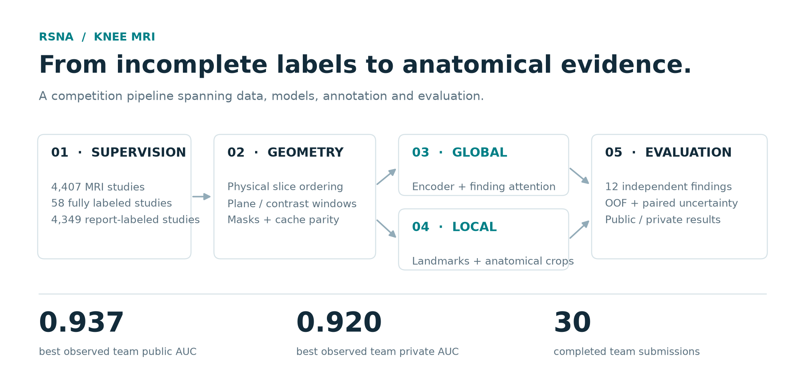
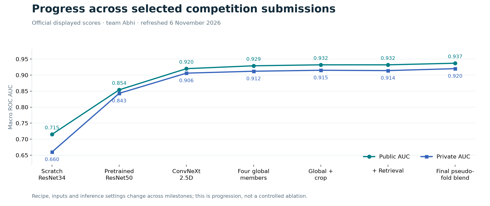

<div align="center">

# Learning knee anatomy from imperfect supervision

**RSNA Knee Abnormality Detection · Competition research & engineering**

Multi-series MRI → anatomy-aware representations → twelve finding probabilities

[](https://github.com/manyakaistha/rsna-knee-mri-portfolio/actions/workflows/ci.yml)


[Competition report](docs/REPORT.md) · [Architecture](docs/ARCHITECTURE.md) · [Reproduction guide](docs/REPRODUCIBILITY.md) · [Model catalog](models/README.md)

</div>



## The challenge

A knee MRI is a collection of variable-length series, acquired in different planes and contrasts. In the available training cohort, only **58 of 4,407 studies had structured labels**. The remaining studies required report-derived supervision, while inference had to work from images alone.

This project explores that problem end to end: physical DICOM geometry, weak-label preparation, slice-window models, finding-specific attention, landmark annotation, anatomical crops, distributed training, ensembling, and statistical evaluation.

## Competition outcome

| Measure | Result | Evidence |
|---|---:|---|
| Best observed team public ROC AUC | **0.937** | [Submission 57450686](https://www.kaggle.com/code/zeroday19/rsna-knee-sub-pseudo5?scriptVersionId=360529781) |
| Best observed team private ROC AUC | **0.920** | [30-submission ledger](evidence/submissions.csv) |
| Final team placement | **3,509 / 6,299** | Participant-provided competition screenshot; [provenance](evidence/provenance.json) |
| Completed accessible team submissions | **30** | Kaggle API refresh, 6 November 2026 |

Results belong to **team Abhi**. Manya Kaistha maintains this showcase; the ledger preserves the submitting accounts (`manyakaistha` and `zeroday19`). Submission ownership does not imply sole authorship. Scores use Kaggle's displayed precision and do not imply clinical readiness.

## Engineering worth exploring

- **Geometry before modeling.** Sort DICOM slices in patient space, preserve plane/contrast identity, and audit legal three-slice windows instead of relying on filenames.
- **Two complementary anatomical approaches.** A zero-initialized ROI residual extension preserves the global model at initialization; an independent crop specialist supplies target-specific ensemble votes.
- **A complete annotation application.** FastAPI, SQLite, browser coordinates, patient-space transformations, resumable assignments, exports, and adjudication.
- **Training that survives real constraints.** Mixed precision, chunked evaluation, gradient checkpointing, distributed gradient checks, and checkpoint/resume contracts.
- **Evidence beyond the best score.** Negative SSL results, rejected augmentations, paired confidence intervals, 119 historical score variants, and explicit separation of Gold, weak-label OOF, public, and private evaluation.



## Start here

For a five-minute review, read the [report overview](docs/REPORT.md#1-executive-summary), inspect the [global/local model](kaggle/armc_roi/model.py), and browse the [geometry tests](kaggle/roi_cache/test_roi_geometry.py).

```bash
python3 -m venv .venv
source .venv/bin/activate
python -m pip install -r requirements.txt -r requirements-dev.txt
python scripts/run_checks.py
```

These checks use synthetic inputs and do not download MRI data or model weights. Data-dependent integration tests skip when their private fixtures are absent. GPU training and historical score reproduction require the inputs described in the [reproduction guide](docs/REPRODUCIBILITY.md).

List historical model assets without downloading them:

```bash
python scripts/download_models.py --list
# Restore one checkpoint, verifying its SHA-256 before installation:
python scripts/download_models.py --name arm13_best.pt
```

## Repository map

| Location | Contents |
|---|---|
| [`docs/REPORT.md`](docs/REPORT.md) | Full competition narrative, outcomes, ablations and lessons |
| [`docs/EXPERIMENTS.md`](docs/EXPERIMENTS.md) | Experiment chronology and source catalog |
| [`kaggle/arm1/`](kaggle/arm1/) through [`kaggle/arm20/`](kaggle/arm20/) | Historical training recipes and ablations |
| [`kaggle/armc_roi/`](kaggle/armc_roi/) | Global + local residual MIL, losses, inference and tests |
| [`kaggle/roi_cache/`](kaggle/roi_cache/) | DICOM geometry, crop generation and web annotation app |
| [`kaggle/portfolio/`](kaggle/portfolio/) | Six configurable research recipes, DDP runner and analysis tools |
| [`kaggle/submissions/`](kaggle/submissions/) | Recovered team inference programs, including late competition blends |
| [`evidence/`](evidence/) | Submission ledger and compact aggregate experiment evidence |
| [`models/`](models/) | 26 release checkpoints with source URLs, sizes and SHA-256 digests |

## Availability and scope

The publication includes available source, configurations, a cleared baseline notebook, aggregate results and model download tooling. MRI scans, radiology reports, patient identifiers, annotation databases, credentials and local caches are excluded. Large local checkpoints had already been retired; 26 recoverable checkpoints are mirrored in the [v1.0.0 release](https://github.com/manyakaistha/rsna-knee-mri-portfolio/releases/tag/v1.0.0), retaining their original provenance. The selected Arm C checkpoint and several final ensemble weights are **not** in that release, so the complete final ensemble cannot currently be reconstructed from this repository alone.

The six-recipe portfolio is implemented and smoke-tested; it is not presented as six completed full training runs. Historical trainer scripts retain their experiment-specific settings. See [reproduction levels](docs/REPRODUCIBILITY.md) and [model limitations](docs/MODEL_CARD.md).

**Research use only.** This is a retrospective competition project, not a validated diagnostic system. Data and pretrained assets retain their original terms; attribution and licensing scope are recorded in [NOTICE.md](NOTICE.md).
