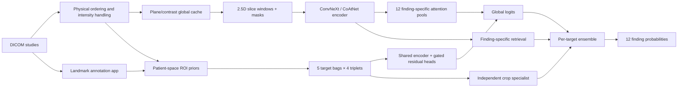

# System architecture

The repository contains historical competition pipelines and a newer configurable research runner. Their checkpoint and input schemas are not interchangeable.

## Global multiple-instance learning

A study is a bag of windows, with three slices forming the input channels. A shared image encoder extracts features. Twelve attention queries aggregate the bag independently, allowing the evidence useful for a meniscal finding to differ from evidence useful for effusion. Attention is an aggregation mechanism, not validated lesion localization.

Historical corpus layouts use 44 or 64 slices; the current portfolio runner additionally enforces legal within-series windows. Missing windows remain explicit in masks. The twelve-label order is fixed across datasets, losses, checkpoints and submission columns.

## Two ROI designs

**Arm C residual path:** `combined[t] = global[t] + sigmoid(beta[t]) * residual[t]` for five targets. Zero-initialized readouts guarantee exact global equivalence before training. Invalid bags have zero correction. Packing all target bags into a chunked encoder pass reduces repeated invocation while preserving logits and gradients.

**Independent crop specialist:** predicts only MCL, lateral meniscus, lateral OA, PF OA and synovitis. It casts a separate vote only on those columns. This is the Arm24 family seen in later ensembles, not Arm C.

## Geometry and annotation

`roi_geometry.py` implements patient/pixel transforms, plane selection, physical ordering and target crop definitions. `build_roi_cache.py` connects annotations to priors, paired side hypotheses, masked windows and provenance. The web application stores immutable cohort hashes, assignments, point events and adjudications in SQLite; image rendering and source-coordinate validation remain server-side.

## Distributed research runner

`portfolio/train.py` validates patient-disjoint fit/dev/locked partitions and records config/input/world-size signatures. It supports global masked-loss normalization, gradient accumulation, mixed precision, complete-epoch checkpoints, per-rank RNG and strict resume. Its new schema is independent of Arm13/Arm24 checkpoints.

The six JSON recipes are executable research configurations. Full training and independent accuracy verification for all six are not documented as complete. The data-free smoke path uses tiny encoders to verify contracts without downloading pretrained assets.

## Source guide

| Concern | Source |
|---|---|
| Reusable global/local model | [model.py](../kaggle/armc_roi/model.py) |
| Residual/loss invariants | [test_model.py](../kaggle/armc_roi/test_model.py), [losses.py](../kaggle/armc_roi/losses.py) |
| Geometry and masks | [roi_geometry.py](../kaggle/roi_cache/roi_geometry.py) |
| Annotation persistence | [database.py](../kaggle/roi_cache/web_annotator/database.py) |
| Click and image services | [services.py](../kaggle/roi_cache/web_annotator/services.py) |
| Distributed runner | [train.py](../kaggle/portfolio/train.py), [data.py](../kaggle/portfolio/data.py) |
| Ensemble analysis | [analyze_ensemble.py](../kaggle/portfolio/analyze_ensemble.py) |
