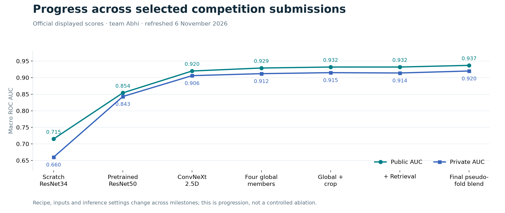

# RSNA Knee Abnormality Detection
## Competition report · 6 November 2026

**Project:** multi-label abnormality detection from multi-series knee MRI  
**Team:** Abhi  
**Showcase maintainer:** Manya Kaistha  
**Competition:** [RSNA Knee Abnormality Detection](https://www.kaggle.com/competitions/rsna-knee-abnormality-detection)

[Overview](#1-executive-summary) · [Data](#2-data-and-supervision) · [Models](#4-model-development) · [ROI engineering](#5-anatomical-modeling-and-annotation) · [Results](#7-competition-results) · [Lessons](#10-lessons-and-next-steps)

## 1. Executive summary

The project developed a study-level MRI classification pipeline for twelve knee findings. Its central difficulty was sparse structured supervision: only 58 of 4,407 training studies carried complete binary labels. Report-derived soft labels supplied the remaining training targets. At inference, models consumed images and series metadata, never report text.

Development progressed from small scratch-trained baselines and custom self-supervised learning to pretrained 2.5D encoders, finding-specific attention pooling, diverse global ensembles, anatomical ROI specialists and retrieval. The engineering work also produced a browser annotation application, physical-coordinate crop builder, cache verification tools and a newer configurable distributed research runner.

The final accessible submission record contains **30 completed team attempts**. The best observed public AUC was **0.937** and the best observed private AUC was **0.920**. The participant's final competition screenshot shows **3,509 of 6,299 teams**. The rank is reported directly; no medal or top-percentile claim is made. From the first scratch submission to the best observed submission, the displayed public AUC increased by **0.222**, and the private AUC by **0.260**. These are end-to-end progression differences, not a controlled attribution to any single technique.

The strongest reproducible contribution of the archive is its engineering and experimental record: alternative hypotheses, failed approaches, explicit validation boundaries, crop and checkpoint invariants, and deployment checks. The final leaderboard systems combine work across the team. Available code does not establish who authored every component, and the result is not presented as one person's isolated model.

### How evidence is used

- **Official submissions:** a fresh authenticated Kaggle API retrieval on 6 November establishes scores, timestamps, submitting accounts and exact scored notebook-version URLs. Pagination continued until no continuation token remained.
- **Final rank:** the participant supplied a screenshot of the competition summary showing 3,509 / 6,299. The submission API does not itself establish this placement.
- **Saved experiments:** numerical summaries, decision records and the 28 October prediction/cache audits establish historical local findings. They are not new training runs.
- **Source:** available trainers establish implemented recipes. Recovered Kaggle programs are latest source snapshots, not guaranteed to be byte-identical to the scored versions linked in the ledger. Late source comments do not prove the corresponding training objective or ancestry.

## 2. Data and supervision

The documented training corpus contains **4,407 studies and 24,371 series**, with approximately 530 GiB of DICOM data. Studies contain multiple planes and contrasts, variable series length, missing acquisitions, scanner differences and inconsistent laterality metadata.

The canonical output order is ACL, MCL, Medial Meniscus, Lateral Meniscus, Medial OA, Lateral OA, PF OA, Effusion, Synovitis, Baker's, Contusion and Fracture. Each target is an independent probability; labels are not mutually exclusive.

### Report-derived labels

The preparation pipeline compares five community label candidates against the 58 structured-label studies, then selects `stevenleehans_v4blend`. Its recorded macro AUC against those labels was approximately **0.8927**. Other recorded candidates were v2 (0.8873), full (0.8780) and pilkwang v2 (0.8700); the dreaddevelopment source had no overlapping Gold IDs and was not selectable.

The result is a 4,349-study training pool with soft targets and a 58-study Gold set. This selection procedure is useful for bootstrapping supervision but consumes Gold information. Silence in a report is also not equivalent to a confirmed negative finding. The label pipeline therefore belongs in the interpretation of every reported result.

The source retains the original label-source references because their provenance is part of the method. Public files contain aggregate metrics, not radiology reports or patient-level labels.

### Validation populations

| Population | Size / structure | What it measures | Main limitation |
|---|---|---|---|
| Gold58 | 58 structured-label studies | Reproduction and gross regressions against real labels | Reused for label-source, checkpoint and ensemble decisions |
| Historical fold 0 | 3,479 fit / 870 held out | Agreement with weak labels under a KFold split | Weak labels and repeated development on the same fold |
| Five-fold OOF | 4,349 pool studies | Out-of-fold predictions for refinement and comparisons | Still report-derived targets; ancestry must be checked |
| Later patient-hash protocol | 3,712 fit-side / 637 locked | A stronger development/locked separation | Historical dependencies can still contaminate a new claim |
| New portfolio subdivision | 3,098 fit / 614 dev / 637 locked | Explicit three-way research contract | Full six-model training is not established as completed |
| Kaggle public/private | Hidden competition partitions | Official competition discrimination | Rounded scores; hidden predictions/labels unavailable locally |

Gold58 was excluded from supervised fitting in the described historical recipes, but was repeatedly used for selection. Two Gold images also participated in the ROI-prior fit/audit history. It should not be described as an untouched test set. The patient audit found one distinct patient per study and no Gold/pool patient overlap using representative headers from all series; it did not scan every slice header.

## 3. MRI representation and preprocessing

### Physical geometry

Slice order is computed from the projection of `ImagePositionPatient` onto the normal derived from `ImageOrientationPatient`. DICOM UID filenames are identifiers, not anatomical order. This matters because three adjacent slices are treated as the channels of a 2.5D input.

The pipeline applies modality handling, intensity normalization and MONOCHROME1 handling, then crops in physical millimetres and stores uint8 image arrays. Quantization is part of the input contract: converting to uint8 and rescaling must match between training and inference.

### Plane and contrast slots

Two influential representations were:

| Recipe | Slot counts: sagittal fluid / sagittal nonfluid / coronal fluid / coronal nonfluid / axial | Span | Stored size |
|---|---|---|---|
| Raptor44 | 12 / 10 / 8 / 6 / 8 | 0.15–0.85 | 44 × 336 × 336 |
| Wide-span cache64 | 18 / 14 / 12 / 8 / 12 | 0.02–0.98 | 64 × 336 × 336 |

The global crop is 140 mm. ConvNeXt consumes 336-pixel inputs; CoAtNet uses 384-pixel inputs. Masks retain missingness instead of silently treating fabricated windows as real observations.

Legacy concatenated-window recipes can create triplets crossing slot boundaries. The newer research runner checks distinct SOPs, one-series membership, compatible normals and increasing physical positions. At most **54 within-slot centers** exist in a fully valid 64-slice, five-slot layout. These corrected windows are a new representation contract and must not be retroactively claimed as the input to every historical run.

### Cache and inference verification

Historical inference programs include sampled byte comparisons against training caches and per-member Gold reproduction checks. A cross-environment ROI check exposed masks that agreed while 8–22% of pixel values differed by 1–3 gray levels. The crop-specialist deployment rebuilt crops in Kaggle using the same builder and environment as training. That incident made preprocessing parity a first-class deployment requirement.

The October metadata audit checked **88,140 ROI window provenance records** across all 4,407 studies, exact global/ROI study order and every retained mask cell. Valid rows had distinct SOPs, increasing positions and no more than 20% padding. This is a provenance audit, not a new raw-DICOM pixel replication.

## 4. Model development

### Scratch and self-supervised baselines

Arm1 used a small scratch ResNet18 attention-MIL baseline and reached Gold AUC about 0.686. Arm2 scaled to a five-slot ResNet34 comparison: scratch reached **0.676893 Gold / 0.715 public / 0.660 private**; custom SSL initialization reached **0.670190 Gold / 0.706 public / 0.666 private**. Scratch won Gold and public, while SSL was slightly higher on the now-visible private score. This is evidence of metric disagreement, not a blanket verdict on self-supervision.

The knee-DINO series exposed uniform-output collapse and BatchNorm-mode problems. A same-slice control stabilized the teacher/student setup, followed by a 40-epoch easy-to-cross-plane curriculum. The curriculum's Gold-from-pool kNN AUC was only **0.5708** and label-neighbor R² was negative. Protocol invariance alone did not produce a strong pathology representation in this pilot.

Longer scratch training (Arm3) and a stabilized GroupNorm/transformer model (Arm4) did not close the gap. These failures motivated the shift toward stronger pretrained encoders.

### Pretrained global models

Arm6's ImageNet-pretrained ResNet50 attention-MIL reached **0.854 public / 0.843 private**. Arm10 combined ConvNeXt-small, higher-resolution 2.5D windows and Raptor44 to reach **0.920 / 0.906**. Arm12 used the wide-span cache64 representation and reached **0.923 / 0.906**. Arm11 and Arm13 supplied CoAtNet-RMLP-2 architecture diversity.

A typical later global recipe used twelve sampled windows during training, twenty-four for epoch validation, and forty-two or sixty-two for final evaluation. The encoder feeds finding-specific query attention, followed by independent logits and sigmoid probabilities. The recipe combines positive-weight BCE, AdamW, separate backbone/head learning rates, and an approximately ten-epoch schedule. Exact settings remain arm-specific.

Arm13's final weight-averaging evaluation exhausted memory. Its recovered **best single-epoch** checkpoint became the warm start for Arm C. Calling `arm13_best.pt` an actual SWA artifact would misstate the run.

### Controlled refinements and negative decisions

| Experiment | Recorded result | Interpretation |
|---|---|---|
| Arm14 attention vs sequential pooling | Fold-0 OOF 0.861561 vs 0.853729 | Retained attention; this does not test every possible sequence design |
| Arm15 report/OOF target refinement | Gold 0.901129; public 0.924; private 0.908 | Small solo improvement; no displayed public gain when added to the older blend |
| Arm16 canonicalization | OOF delta +0.001440, below +0.002 gate | Rejected despite a larger Gold movement |
| Arm18 masking uncertain supervision | Informative-cell OOF delta −0.000314 | Rejected; does not prove report silence is truly negative |
| Arm19 augmentation | OOF delta −0.000336 | Rejected under the predefined margin |
| Arm20 longer augmentation comparison | OOF delta +0.000771, below +0.002 | Rejected despite improved Gold |
| 3D multi-plane submission | Public 0.871, private 0.863 | Did not match the strongest 2.5D systems in the accessible history |

The [experiment catalog](EXPERIMENTS.md) covers the additional attempted arms, incomplete runs and exact source locations. Local comparisons often differed in window count, TTA, training population or selection policy; those differences prevent clean causal attribution.

## 5. Anatomical modeling and annotation

### Landmark tooling

A browser annotation application was developed with FastAPI and SQLite. It supports cohort registration, hashed manifests, reader assignments, token-based access, click-to-source-pixel mapping, DICOM patient-space conversion, resumable work, durable annotation events, backups, per-reader exports and adjudication.

The documented workflow expands a 20-study pilot with 80 landmark tasks into a 100-study cohort with 400 tasks. Four landmarks define the crop priors. The final cohort separates 80 fit and 20 audit studies. The software exposes workflow gates; its existence does not by itself certify clinical validation or independent expert consensus.

The geometry implementation corrected a pixel/patient inverse issue by solving the coordinate system rather than assuming perfect orthogonality. Browser display resizing and canvas coordinates receive dedicated tests so a visually correct click cannot silently be stored in a different coordinate frame.

### Laterality without guessing

Only **2,202 / 4,407 studies (49.97%)** had decisive DICOM laterality under the ROI contract. A crop policy requiring reliable laterality in 95% of cases could not pass. The adopted solution creates paired left/right hypotheses for MCL, lateral meniscus and lateral OA, with target attention selecting useful windows. Known side remains audit metadata.

PF OA uses overlapping triplets; synovitis uses suprapatellar-centered windows with a reviewed sagittal policy shifted 25 mm inferiorly. Truncated acquisitions stay masked. Each target has four three-slice windows, stored as `[N, 4, 3, 336, 336]`.

### Arm C: a bounded correction to the global path

Arm C shares Arm13's CoAtNet encoder with five target-specific gated ROI residual heads. Each residual affects only its matching target. Readout weights and biases start at zero, making a freshly warm-started model exactly equal to the original global model. Empty ROI masks are also a no-op. These are executable model contracts, not merely architectural intentions.

The selected checkpoint's 486 mapped global tensors were unchanged in the historical audit, while the ROI heads were nonzero. That finding rejected global-path forgetting as the explanation for this selected model's behavior.

Fresh October paired bootstrap results on reused Gold58 were:

| Inference | Global AUC | Combined AUC | Delta | Paired 95% interval |
|---|---:|---:|---:|---|
| K62 | 0.893141 | 0.894724 | +0.001583 | [−0.000282, +0.003944] |
| K24 | 0.890947 | 0.891726 | +0.000779 | [−0.002059, +0.003919] |

Both intervals cross zero. The bootstrap attempted 2,000 draws with seed 20261028; 1,999 were valid with all twelve targets scorable. It conditions on the already selected model and does not correct repeated Gold selection. Aligned-ROI permutation controls supported investigating a small effect, but calibration gains persisted after shuffling, limiting a strong anatomical explanation.

The official Arm C submission reached **0.920 public / 0.898 private**. It used K24 and must not be treated as a controlled comparison against a differently configured Arm13 submission.

### Arm24: independent crop specialist

Arm24 is a different design: a crop-only member casts a separate rank vote for five findings, while the other seven retain the global-only blend. Its September submission reached **0.932 public / 0.915 private**. Its description reports a +0.0043 blended OOF improvement on 870 studies, but exact private training source and the associated keyed evidence were not recovered. That reported local gain is attributed to the submission description, not independently replicated here.

## 6. Ensembling, retrieval and late competition work

Architecture and input diversity improved the earlier global blend: Arm11+12 reached **0.927 / 0.911**, and four global members with reversal TTA reached **0.929 / 0.912**. Adding Arm15 tied the displayed public score. Reducing to K24 while removing TTA scored **0.927 / 0.911**; changing both factors makes it a combined runtime/accuracy experiment.

Arm27 adds finding-specific retrieval. A query retrieves 32 neighbors at temperature 0.07 from attention-pooled embeddings of 3,479 fit studies, using an Arm20 fold-0 encoder at K24. Each finding receives a similarity-weighted label vote. This avoids reducing a focal finding to a single study-average vector. The reported local improvement was promising, but the crop+retrieval submission tied public 0.932 and scored private 0.914 versus 0.915 for the earlier crop blend. There is no demonstrated incremental hidden-test gain from that pair.

The late October record was missing from the older local reports. The November refresh establishes these additional outcomes:

| Scored notebook family | Public | Private | What can be established |
|---|---:|---:|---|
| `sub-armmr` | 0.933 | 0.915 | Completed score; latest inference adds an `arm20mr` member |
| `sub-armevf` | 0.934 | 0.916 | Completed score; latest inference introduces an EVF-named member |
| `sub-evf2solo` | 0.929 | 0.910 | Official solo-labelled notebook score; training details unavailable |
| `sub-evffold` | 0.936 | 0.919 | Two completed records at displayed tie |
| `sub-evf5` | 0.936 | 0.920 | Two completed records at displayed tie |
| `sub-pseudo5` | **0.937** | **0.920** | Best observed public submission; tied best observed private score |

The recovered latest `pseudo5` inference declares four historical global members, five pseudo-fold checkpoint members, the crop specialist and a retrieval member, with reversal TTA disabled. The latest `evf5` source instead declares five EVF/no-augmentation fold members. Both contain strict-validation exceptions for several late members. Names and comments alone do not certify how these folds were trained, which labels were used, or whether teacher ancestry was split-clean. Exact final training sources, several weights and the retrieval database remain unavailable in this publication.

## 7. Competition results

The complete [CSV](../evidence/submissions.csv) and [JSON](../evidence/submissions.json) preserve all 30 accessible completed attempts with scored notebook-version links. Best observed submission scores should not be confused with a claim about which submissions the team selected for final ranking. The final rank is separately evidenced by the supplied competition screenshot.

The best public submission's **0.937 public / 0.920 private** gap is 0.017 at displayed precision. It shows why public optimization alone is an incomplete account of generalization. The private scores also revise several earlier interpretations: the custom SSL submission slightly exceeded scratch privately, and retrieval did not exceed the preceding crop blend privately.

No hidden prediction matrices or labels were recovered, so this report cannot calculate hidden-test paired confidence intervals or statistical significance between close submissions.

## 8. Distributed training and resource engineering

The later portfolio runner implements six recipes: ConvNeXt global MIL, CoAtNet global MIL, a plane/contrast hierarchy, an independent ROI specialist, EfficientNet global MIL and a metric-auxiliary ConvNeXt. It validates split membership, encoder ancestry, ROI-prior ancestry, source-window legality and target order. It uses fixed final-epoch selection, explicit budget accounting and one process per GPU.

Engineering features include observed-cell loss normalization across ranks, accumulation, mixed precision, per-rank RNG state, checkpoint signatures, strict resume contracts and a staged prediction interface. ROI fusion preserves global predictions wherever local evidence is unavailable.

A historical fixed-global-batch-eight cost probe measured **4.807 studies/s on one GPU** and **8.908 studies/s on two-rank DDP**, a **1.853×** speedup. A controlled distributed gradient comparison differed by at most **7.45e−9**. These were bounded cost/correctness fixtures; they are not proof of full-run scaling or a trained six-model ensemble.

A small frozen-feature screen used 96 fit and 64 dev studies. B2 reached weak-label AUC **0.640976**, DINOv2 **0.527105**, and uniform averaging **0.621904**. This screen did not support adding that frozen DINO representation. A separate tiny image pilot had only eleven scorable targets, so its 0.553030 mean is not a twelve-target validation score.

Operational lessons included separating training memory from evaluation chunking, avoiding CUDA/NCCL work before unsafe process forks, using zero-worker loaders when required, keeping checkpoints available independently of failed kernels, and pinning inference inputs rather than allowing a later notebook push to silently replace them.

## 9. Reproducibility and publication scope

This repository includes available training/inference code, six research configurations, synthetic tests, the annotation app, an output-cleared baseline notebook, official submission metadata, compact experiment summaries and aggregate statistical audits. The model catalog resolves 26 historical assets from the original team GitHub release, mirrored in this repository’s v1.0.0 release after full download and SHA-256 verification.

Large local image arrays and trained checkpoints were removed during an earlier storage retirement. Restoring source does not restore those bytes. In particular, the selected Arm C checkpoint is known by its historical hash but is not among the confirmed upstream release assets. The release also lacks several weights required for the final best ensemble.

The publication excludes patient images, raw radiology text, patient identifiers, label matrices, annotation databases, access tokens, caches, local environment files, operational transcripts and redundant generated bundles. Aggregate score audit paths refer to the original private workspace; they document the calculation's origin, not files promised in the public tree.

Fresh public-repository validation is recorded in [VALIDATION.md](VALIDATION.md). It covers source integrity and data-free behavior. Full MRI inference, retraining, GPU/CUDA parity and exact final-score reproduction are separate tasks requiring the missing authorized inputs.

## 10. Lessons and next steps

**Input fidelity can matter as much as architecture.** Physical ordering, slot legality, quantization and crop parity determine what a model actually sees. A mathematically identical network with different preprocessing is a different deployed system.

**Small validation sets encourage persuasive but unstable narratives.** Several changes improved Gold while failing a larger weak-OOF gate or giving no public benefit. The private results reinforce the need to report all evaluation populations separately.

**Negative experiments are useful when their scope is precise.** One SSL curriculum, one sequential head or one augmentation schedule can fail without ruling out the broader technique. Recording the controlled comparison prevents overgeneralized conclusions.

**Anatomical inductive bias needs a measured contribution.** ROI availability, target isolation and zero-residual guarantees are strong software properties. They do not automatically imply clinical localization or a statistically secure AUC gain.

**Ensemble diversity must justify its operational cost.** Retrieval, TTA and additional folds should earn their place using fixed evaluation rules and runtime constraints. A small local change does not guarantee hidden-test value.

The next scientifically defensible phase would obtain new adjudicated evaluation data, freeze split-clean teacher and prior ancestry, run repeated seeds for the anatomical model, evaluate calibration and target-specific operating points, and measure performance across scanner/protocol subgroups. Recovering the exact final training artifacts would also close the current reproducibility gap.

## 11. References

- Ilse et al., [Attention-based Deep Multiple Instance Learning](https://proceedings.mlr.press/v80/ilse18a.html), 2018.
- Liu et al., [A ConvNet for the 2020s](https://arxiv.org/abs/2201.03545), 2022.
- Dai et al., [CoAtNet: Marrying Convolution and Attention for All Data Sizes](https://arxiv.org/abs/2106.04803), 2021.
- Caron et al., [Emerging Properties in Self-Supervised Vision Transformers](https://arxiv.org/abs/2104.14294), 2021.
- Oquab et al., [DINOv2: Learning Robust Visual Features without Supervision](https://arxiv.org/abs/2304.07193), 2023.
- [timm / PyTorch Image Models](https://github.com/huggingface/pytorch-image-models).
- [Original team model release](https://github.com/XERO47/rsna-knee-mri/releases/tag/model-weights).
- [Community report labels](https://www.kaggle.com/datasets/stevenleehans/rsna-knee-llm-report-labels), [Raptor corpus](https://www.kaggle.com/datasets/dreaddevelopment/knee-raptor-corpus).

Literature motivates mechanisms; the project measurements establish the results reported here.
